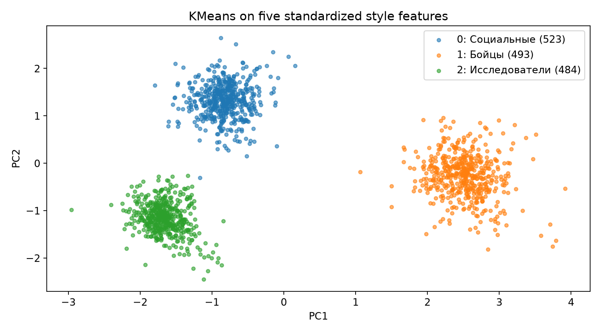

# Лабораторная работа № 4

ML-классификация стилей игроков, сегментация и прогноз ухода.
Дисциплина «Игровой искусственный интеллект».

**Студент:** Печенов В. В. · **Группа:** ИВТ-465 · **Дата:** 17.11.2026.
**Стек:** Python / pandas / scikit-learn / matplotlib / Jupyter.

**[Выполненный ноутбук](notebooks/lab04.ipynb)** · **[Отчёт PDF, 7 страниц](docs/report.pdf)** · **[Видео на Google Диске, 2:30](https://drive.google.com/file/d/16_9lB4B5q-uqfK1K0I6sSPdAFcyb1WT4/view?usp=drivesdk)** · **[Release v1.0](https://github.com/VladimirPechenov/lab04-ml-players/releases/tag/v1.0)**

Видео с поясняющими надписями, без звука; показывает реальные данные, графики и метрики расчёта.
Просмотр на Диске открыт всем по ссылке. Резервная копия MP4 находится в Release, вне истории Git.

## Соответствие опубликованным требованиям

- [x] Jupyter-ноутбук выполнен целиком: все пять этапов, выводы и графики сохранены.
- [x] **16 признаков** на игрока, в том числе пять добавленных к исходному набору.
- [x] KMeans, сравнение k=2..7 по silhouette, **3 интерпретируемых кластера**, PCA 2D и ARI.
- [x] Churn-классификатор: **test ROC-AUC 0,9127 ≥ 0,70**, без временной утечки.
- [x] Dummy baseline, логистическая регрессия и RandomForest (300 деревьев), precision@top-20%.
- [x] График permutation importance и сравнение с намеренной утечкой.
- [x] Отчёт по разделам шаблона, Markdown и PDF на 7 страниц.
- [x] Коммиты по этапам `step-1`, `step-2`, `step-3`, `step-4`; видео по ссылке, без MP4 в Git.
- [x] Тег `v1.0`, GitHub Release и автоматическая проверка GitHub Actions.

Требования взяты из [README преподавателя](https://github.com/kolesnikov-vstu-gameai/lab04-ml-players)
и его [шаблона отчёта](https://github.com/kolesnikov-vstu-gameai/lab04-ml-players/blob/Master/docs/report.md).
Отдельные методические указания и официальный титульный лист отсутствуют; пользователь подтвердил,
что других материалов нет. PDF оформлен как учебный протокол, соответствие отсутствующему
кафедральному шаблону не заявляется. Сверка требований: [docs/requirements.md](docs/requirements.md).

## Результаты

Данные **синтетические**, как разрешено заданием: 1500 игроков, 24 980 сессий, seed=42.
Скрытая вовлечённость влияет на поведение и будущий возврат с шумом; она не записывается в признаки.
У каждого игрока есть хотя бы одна сессия в окне наблюдения. Реальная телеметрия не использовалась.

| Модель | Validation ROC-AUC | Test ROC-AUC | Precision@top-20% |
|---|---:|---:|---:|
| Dummy (prior) | 0,5000 | 0,5000 | 0,4167 |
| LogisticRegression | **0,8690** | **0,9127** | **0,9833** |
| RandomForest | 0,8640 | 0,9121 | 0,9500 |

По validation выбрана LogisticRegression. Test: 300 игроков; top-20%: 60 игроков, 59 из них ушли.
95% bootstrap-интервал test AUC: **[0,882; 0,940]** (500 перевыборок, для фиксированной модели).
Сначала выполнен выбор модели по validation, затем оценка test; тестовые оценки не используются для настройки.
Dummy даёт одинаковый риск всем: его precision зависит от стабильного порядка индексов.

| Кластер | Название | Игроков | Отличительные средние |
|---|---|---:|---|
| 0 | Социальные | 523 (34,9%) | chats/session = 10,96 |
| 1 | Бойцы | 493 (32,9%) | kills/session = 9,01 |
| 2 | Исследователи | 484 (32,3%) | explored = 0,85 |

Silhouette = **0,6910**, ARI = **1,0000**, две компоненты PCA сохраняют **90,45%** дисперсии.
Названия даны по профилям; archetype применяется только для внешней проверки ARI.
KMeans использует 5 признаков стиля; churn — все 16, без cluster и метаданных.



## Защита от утечки

- Прогноз делается после дня 20. Признаки считаются **только по дням 0–20** внутри `player_features`.
- `churn=1`: **нет сессий в дни 21–30**. Метка заново вычисляется из будущих событий.
- Разбиение по игрокам, стратифицированное: train / validation / test = **900 / 300 / 300**.
- StandardScaler LR обучается на train внутри Pipeline. Параметры моделей заданы заранее.
- В намеренно неверном эксперименте `last_day` за дни 0–30 даёт **AUC=1,0000**:
  признак уже кодирует отсутствие будущих визитов. В честной модели `last_day <= 20`.
- Коррелированные признаки делят важность; permutation importance не трактуется как причинный эффект.

## Запуск и воспроизведение

Python **3.12+**. На Windows можно запустить **RUN.cmd**; при первом запуске создаётся среда
и устанавливаются зависимости. Для проверки — **CHECK.cmd**.

Вручную, из корня репозитория:

```powershell
py -3.12 -m venv .venv
.\.venv\Scripts\python.exe -m pip install -r requirements.txt
.\.venv\Scripts\python.exe -m lab04.experiment
.\.venv\Scripts\python.exe -m jupyter lab notebooks/lab04.ipynb
```

Linux/macOS: `python3 -m venv .venv`, затем `.venv/bin/python` вместо Windows-пути.
Проверки и повторное выполнение ноутбука:

```bash
python -m ruff check .
python -m pytest
python -m jupyter nbconvert --to notebook --execute --inplace --ExecutePreprocessor.timeout=300 notebooks/lab04.ipynb
```

Основные версии закреплены в `constraints.txt` и применяются через `requirements.txt`.
Фактические версии прогона и все player_id разбиений: [results/metrics.json](results/metrics.json).
Дополнительные инструменты оформления: `pip install -e ".[artifacts]"`.
PDF: `python tools/build_report.py`; видео: `python tools/build_video.py`.
Для шрифтов оформления используются Arial на Windows или DejaVu на Linux.

## Структура и порядок выполнения

1. `step-1`: определены окна, генератор данных, 16 признаков и перечень требований.
2. `step-2`: реализованы модели, выбор k, честное сравнение и эксперимент с утечкой;
   сохранены CSV, PNG и JSON, добавлены тесты временных границ и независимости выборок.
3. `step-3`: выполнен ноутбук, подготовлены PDF/Markdown, видеопротокол и инструкции запуска.
4. `step-4`: финальная сверка, фиксация зависимостей и CI с выполнением ноутбука, публикация.

| Путь | Содержимое |
|---|---|
| `data/events.csv` | Исходные синтетические сессии |
| `src/lab04/` | Генератор, признаки, модели и единый запуск эксперимента |
| `notebooks/lab04.ipynb` | Основной выполненный ноутбук с пояснениями |
| `results/` | Признаки, метки, профили, split, прогнозы test, метрики и графики |
| `docs/report.md`, `docs/report.pdf` | Отчёт по разделам исходного шаблона |
| `tests/` | Четыре проверки, в том числе утечка и качество |
| `tools/` | Воспроизводимое оформление ноутбука, PDF и видео |
| `videos/chapters.json` | Таймкоды; MP4 исключён из Git и лежит на Диске/в Release |

Высокие показатели на этой синтетике не гарантируют качество на реальных игроках. Для внедрения
нужны независимая временная проверка, обработка неполного будущего окна, калибровка рисков и
A/B-тест действий удержания. Влияние бонусов на возврат здесь не измерялось.
