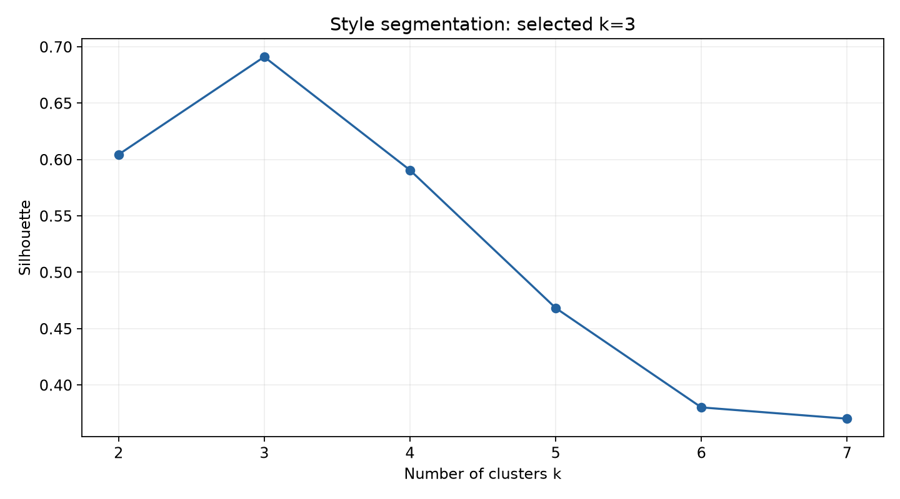
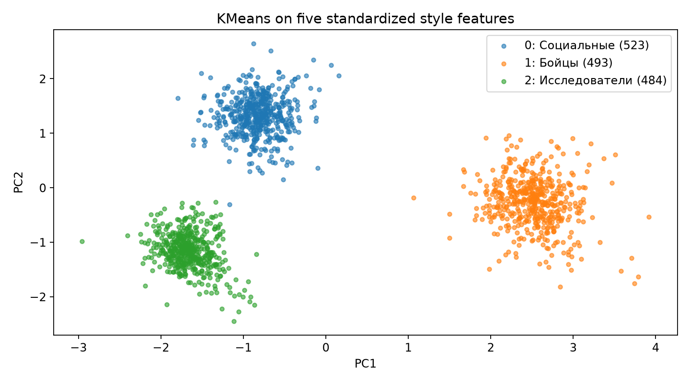
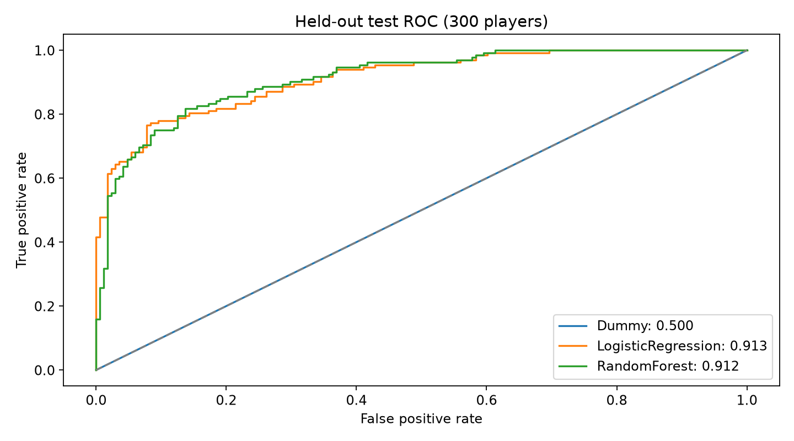
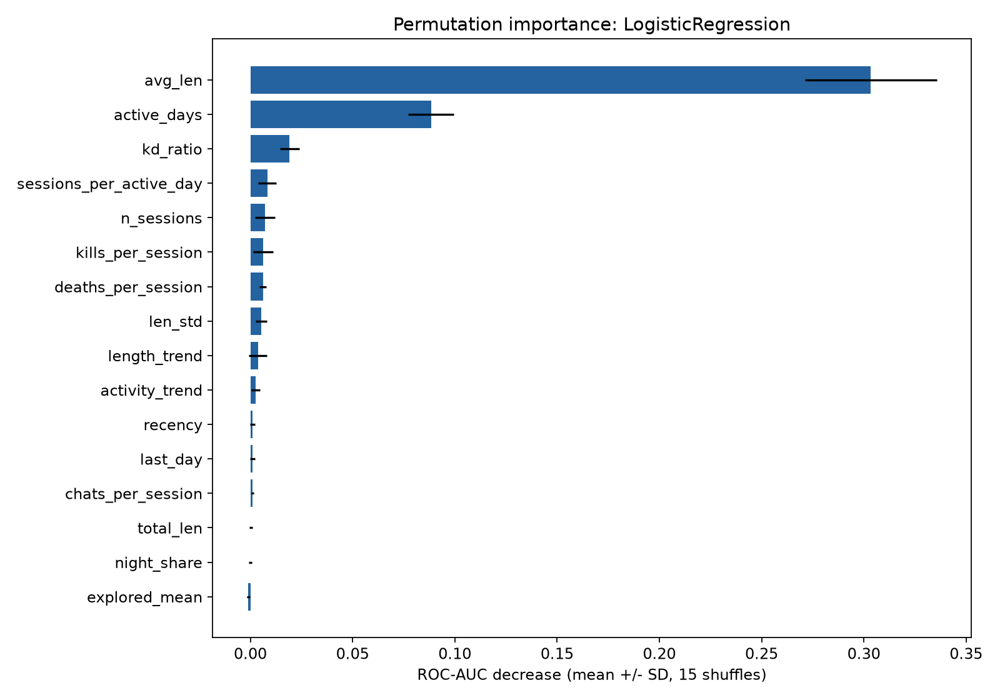

ЛАБОРАТОРНАЯ РАБОТА № 4

ML-классификация стилей игроков и сегментация

Дисциплина «Игровой искусственный интеллект»

Студент: Печенов В. В.

Группа: ИВТ-465

Стек: Python, pandas, scikit-learn, matplotlib, Jupyter

Дата выполнения: 17.11.2026

## 1. Цель работы

Построить воспроизводимый анализ поведения игроков: получить признаки из сессий, выделить интерпретируемые стили и оценить вероятность ухода без использования будущей информации.

Работа выполнена по опубликованному шаблону преподавателя. Отдельные методические указания и официальный титульный лист не предоставлены. Этот документ является учебным протоколом объёмом 7 страниц; оформление по отсутствующему кафедральному шаблону не заявляется.

https://github.com/VladimirPechenov/lab04-ml-players

## 2. Постановка задачи и данные

Требуется выполненный Jupyter-ноутбук; 10+ признаков на игрока; кластеризация с обоснованием k, интерпретацией и 2D; churn-классификатор с ROC-AUC не ниже 0,70; график важности признаков. Дополнительно выполнены baseline, precision в top-20%, контроль утечки, история коммитов по этапам, видео, тег и Release.

Использована разрешённая синтетика: 1500 игроков, 24980 сессий, фиксированный seed=42. Данные не являются телеметрией реального продукта. Три архетипа задают интенсивность боя, исследования и общения. Непрерывная скрытая вовлечённость влияет на наблюдаемую активность и вероятность будущего возврата с шумом.

Генератор не хранит вовлечённость как столбец. Результирующая таблица содержит player_id, session_id, day, hour, length_s, kills, deaths, explored, chats, archetype и churned. Каждый игрок имеет хотя бы одну сессию в наблюдаемом окне; новые игроки без истории в данную модель не входят. Дубликатов session_id и пропусков нет.

| Элемент | Определение |
|---|---|
| Момент прогноза | После завершения дня 20 |
| Признаки | Только сессии дней 0–20 включительно |
| Метка churn=1 | Нет ни одной сессии в дни 21–30 включительно |
| Доля ухода | 44.07% (661 игроков) |
| Метаданные | archetype только для ARI; churned только для сверки меток |
| Разбиение | По игрокам: train 900 / validation 300 / test 300 |

Сначала независимо формируются события окна наблюдения, затем будущие события. Метка для обучения заново выводится из наличия будущих сессий функцией churn_labels. Одинаковые player_id не пересекаются между выборками. Split сохранён в metrics.json.

Результаты воспроизводятся командой python -m lab04.experiment; таблицы исходных событий, признаков и меток сохранены в data/events.csv, results/features.csv и results/labels.csv.

## 3. Реализация: признаки и архитектура

| Признаки | Расчёт по наблюдаемым сессиям |
|---|---|
| n_sessions, avg_len, total_len | Количество уникальных сессий; среднее и сумма length_s |
| kills_per_session, deaths_per_session | Средние kills и deaths |
| kd_ratio | (sum(kills)+1)/(sum(deaths)+1) |
| explored_mean, chats_per_session | Средние explored и chats |
| active_days, last_day | Число уникальных day; максимальный day <= 20 |
| sessions_per_active_day | n_sessions / active_days |
| len_std (собственный) | Стандартное отклонение длительности, 0 при одной сессии |
| night_share (собственный) | Доля сессий, начавшихся в часы 0–5 |
| length_trend (собственный) | Наклон регрессии length_s по day; 0 при одном дне |
| activity_trend (собственный) | (N(11–20)/10 - N(0–10)/11) / (N(0–20)/21) |
| recency (собственный) | 20 - last_day |

Итого 16 числовых признаков. Идентификаторы, метка, архетип и номер кластера в churn-модель не передаются. Все значения конечны. Тренды не зависят от порядка строк. Временной фильтр применяется внутри player_features, что защищает вызывающий код от случайного использования будущих дней.

Модули: make_dataset.py генерирует события; features.py агрегирует историю и вычисляет метки; models.py выполняет кластеризацию и оценку классификаторов; experiment.py сохраняет артефакты. Ноутбук связывает все пять этапов и показывает реальные выходы выполненных ячеек.

Для сегментации выбраны пять признаков стиля: убийства, смерти, K/D, исследование и чаты. Так частота визитов не подменяет стиль вовлечённостью. Перед KMeans применяется StandardScaler. Для churn используются все 16 признаков; scaler LR обучается только на train внутри Pipeline.

## 4. Демонстрация сегментации

Для k=2..7 выполнен KMeans с n_init=20 и random_state=42. Максимум silhouette 0.691 достигается при k=3. ARI относительно скрытых архетипов: 1.000. PCA сохраняет 90.4% дисперсии в двух компонентах. PCA служит только для показа.

Оба графика построены на наблюдаемом окне. ARI не используется при выборе k и не входит в признаки. Высокое совпадение объясняется чётко разделёнными синтетическими стилями.

## 5. Интерпретация и прогноз ухода

| Кластер / стиль | Игроков | Kills | Explore | Chats |
|---|---|---|---|---|
| 0 / Социальные | 523 (34.9%) | 2.99 | 0.50 | 10.96 |
| 1 / Бойцы | 493 (32.9%) | 9.01 | 0.25 | 1.01 |
| 2 / Исследователи | 484 (32.3%) | 2.04 | 0.85 | 1.99 |

«Бойцам» подходят боевые испытания; «Исследователям» - новые области и секреты; «Социальным» - кооперативные события. Названия получены по средним профилям, не скопированы из archetype. Кластер - описание поведения, а не неизменный тип личности.

DummyClassifier(strategy=prior) задаёт уровень случайного ранжирования. Baseline: LogisticRegression(C=1, max_iter=2000) со стандартизацией. Альтернатива: RandomForest с 300 деревьями, min_samples_leaf=5. Гиперпараметры зафиксированы заранее. Лучшая модель выбирается только по validation AUC.

| Модель | Val AUC | Test AUC | P@20% |
|---|---|---|---|
| Dummy | 0.5000 | 0.5000 | 0.4167 |
| LogisticRegression | 0.8690 | 0.9127 | 0.9833 |
| RandomForest | 0.8640 | 0.9121 | 0.9500 |

Выбрана LogisticRegression; test ROC-AUC = 0.9127, 95% bootstrap-интервал [0.882; 0.940] (500 перевыборок тестовых игроков). Это интервал для фиксированной обученной модели, он не учитывает вариативность генератора и обучения.

Precision@top-20% измеряет долю ушедших среди 60 тестовых игроков с наибольшим риском. При равных рисках Dummy используется стабильный порядок индексов; его precision зависит от этого порядка.

## 6. Важность признаков и контроль утечки

Permutation importance измеряется как снижение test ROC-AUC после перестановки признака (15 повторов, полосы - стандартное отклонение). Признаки после анализа не отбирались, модель не переобучалась по test. Отрицательное значение возможно из-за случайности. Коррелированные avg_len, total_len и n_sessions делят между собой важность.

Наибольшее среднее падение AUC у avg_len: 0.3034. Это связь с прогнозом модели, а не причинный эффект: увеличение длительности само по себе не доказывает снижение ухода. Синтетическая вовлечённость влияет и на поведение, и на возврат.

| Эксперимент на тех же test-игроках | ROC-AUC |
|---|---|
| Честная модель: признаки только 0–20 | 0.9127 |
| Намеренная утечка: last_day из 0–30 | 1.0000 |

В эксперименте с утечкой отдельная LR видит максимальный день за весь горизонт: отсутствие дня >=21 совпадает с определением ухода. Такая идеальная оценка не имеет практической ценности для прогноза в конце дня 20. Для честной модели максимум ограничен днём 20.

## 7. Проверки, выводы и литература

Проверены: независимость признаков от будущих сессий и метаданных; устойчивость к перемешиванию строк; корректность меток; конечность признаков для одной сессии; отсутствие пересечения игроков между train/validation/test; выбор k по silhouette; ROC-AUC >=0,70 на независимом синтетическом прогоне; корректность precision top-20%. Линтер и pytest запускаются также в GitHub Actions.

Ноутбук выполнен целиком, сохранены execution_count и выводы всех ячеек. results/metrics.json содержит seed, параметры окон, версии, разбиение и метрики. CSV профилей, тестовых прогнозов и permutation importance позволяют независимо проверить таблицы.

Достигнуты 3 интерпретируемых сегмента и test AUC 0.913; порог задания выполнен. По validation выбрана логистическая регрессия, сложный ансамбль преимущества не показал. Продемонстрирована опасность временной утечки.

Ограничения: одна синтетическая популяция и один основной seed; простая модель вовлечённости; полностью известный будущий горизонт. Для реальной игры нужны временной holdout, обработка цензурирования, калибровка рисков и проверка стабильности сегментов. Эффект предложений удержания проверяется A/B-тестом; прогноз ухода сам по себе не доказывает пользу бонуса.

## Источники

1. Задание и шаблон: github.com/kolesnikov-vstu-gameai/lab04-ml-players (дата обращения: 17.11.2026).

2. Scikit-learn. Clustering, silhouette: scikit-learn.org/stable/modules/clustering.html.

3. Scikit-learn. Data leakage: scikit-learn.org/stable/common_pitfalls.html.

4. Scikit-learn. Permutation importance: scikit-learn.org/stable/modules/permutation_importance.html.

## Приложение. Материалы и повторение

https://github.com/VladimirPechenov/lab04-ml-players

Установка: python -m pip install -r requirements.txt. Расчёт: python -m lab04.experiment. Ноутбук: jupyter lab notebooks/lab04.ipynb. Проверки: python -m ruff check .; python -m pytest. Видео и Release связаны из README. Видео хранится вне Git.

Версии основного прогона: Python 3.12.0; numpy 2.5.5; pandas 3.1.1; scikit-learn 1.9.1; matplotlib 3.11.2
